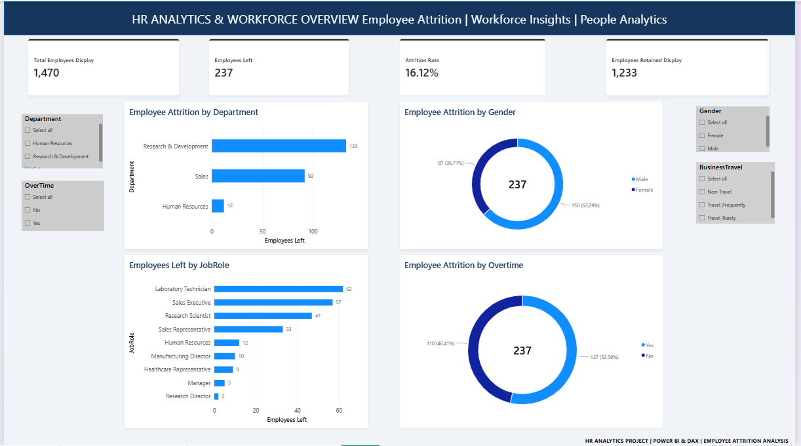
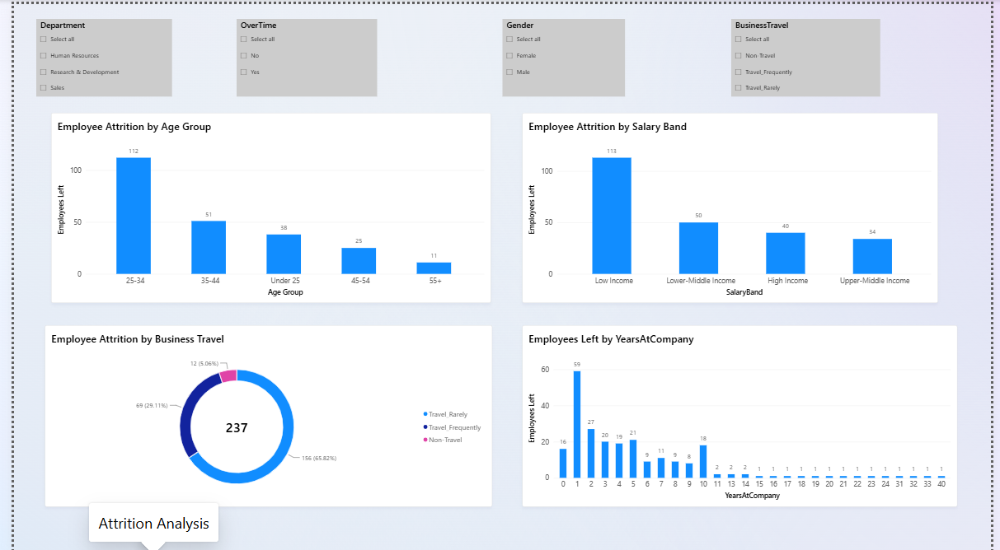
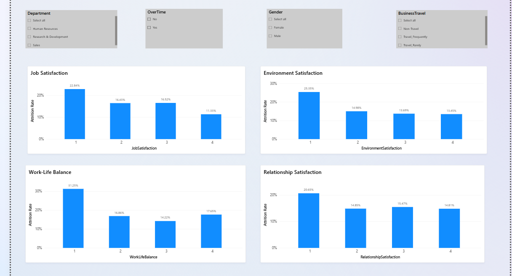

# HR Employee Attrition Analytics | Power BI

## Project Overview
An interactive HR Analytics dashboard developed using Microsoft Power BI to analyze employee attrition, workforce demographics, job satisfaction, and organizational trends.

## Tools & Technologies
- Microsoft Power BI
- DAX (Data Analysis Expressions)
- Power Query
- Data Visualization
- Microsoft Excel

## Dashboard Pages

### 1. HR Overview
- Total employees and employee attrition
- Attrition by department and job role
- Gender-wise attrition
- Overtime analysis

### 2. Attrition Analysis
- Attrition by age group
- Attrition by salary band
- Business travel analysis
- Employee attrition by years at company

### 3. Employee Satisfaction
- Job satisfaction analysis
- Environment satisfaction
- Work-life balance
- Relationship satisfaction

## Key Metrics
- Total Employees: 1,470
- Employees Left: 237
- Employees Retained: 1,233
- Overall Attrition Rate: 16.12%

## Key Skills Demonstrated
- HR data analysis
- DAX measures and calculations
- Interactive dashboard development
- Workforce insights and reporting
- Data-driven decision-making

## Project File
The `.pbix` file is available in this repository for exploring the dashboard.

---
**Developed by Bijoy Das**  
HR Analytics | Power BI | Data Analysis
## Dashboard Preview

### 1. HR Overview

### 2. Employee Attrition Analysis

### 3. Employee Satisfaction

